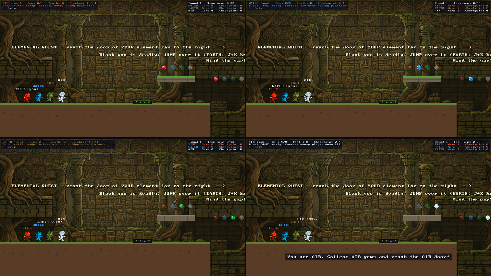
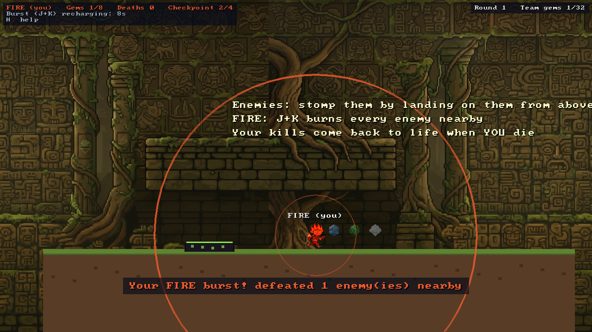
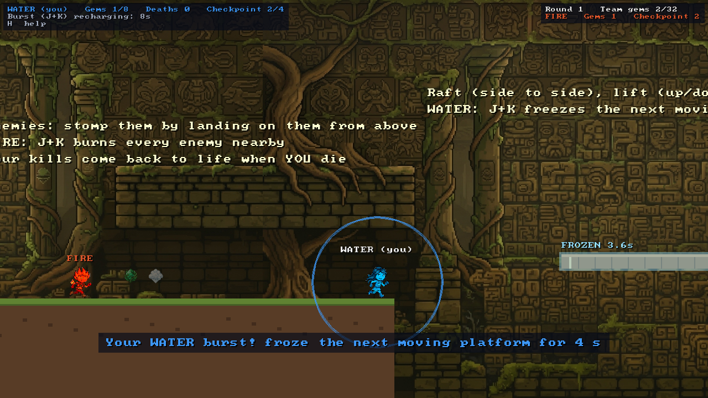
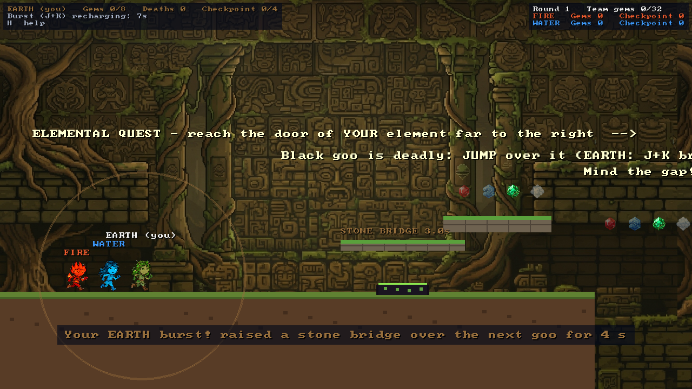
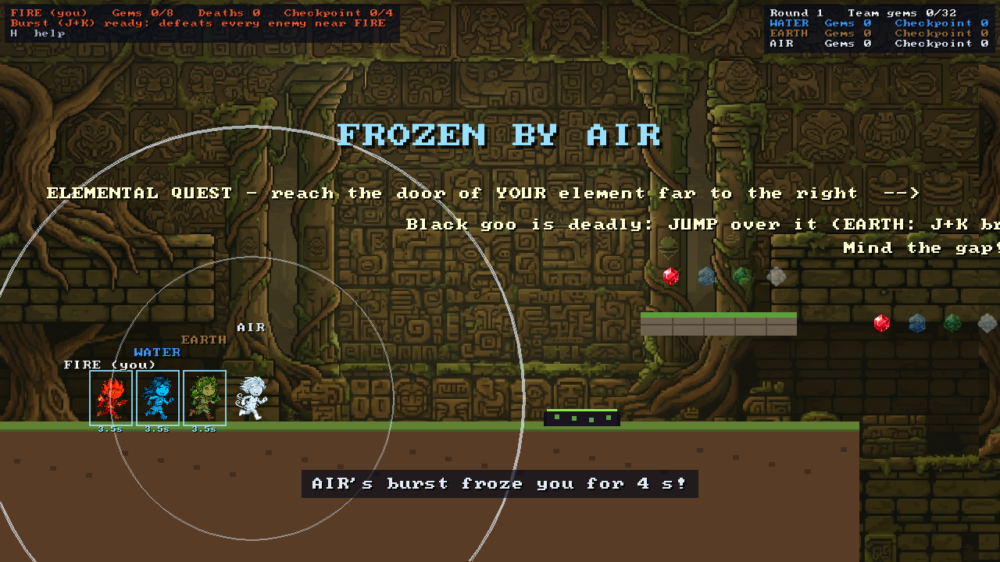
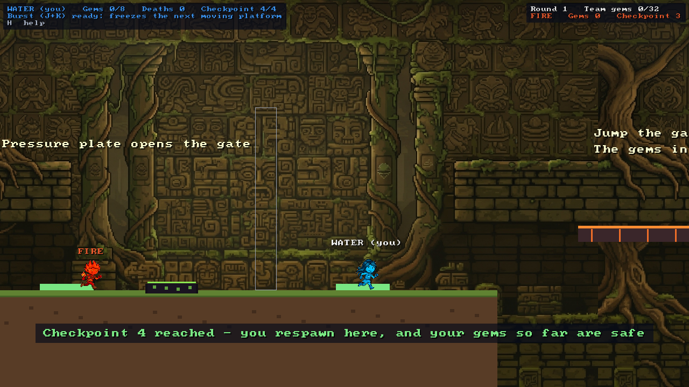
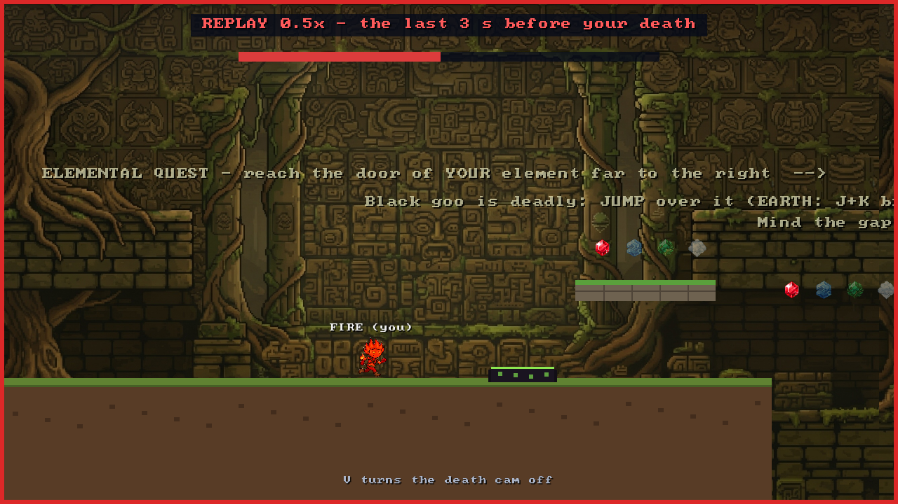
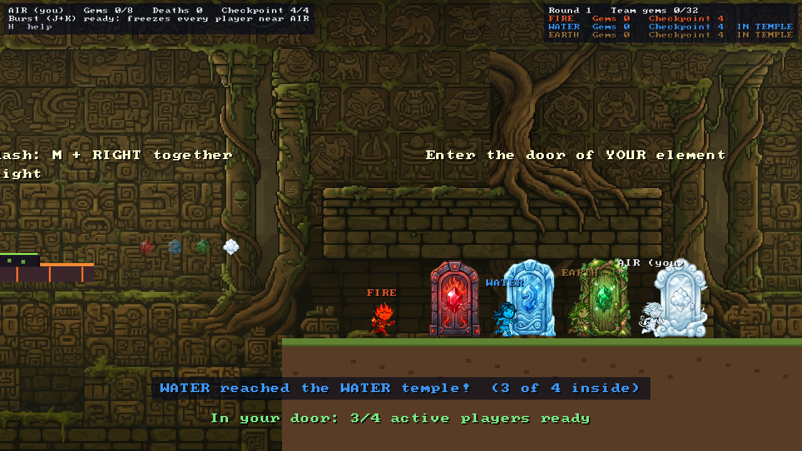
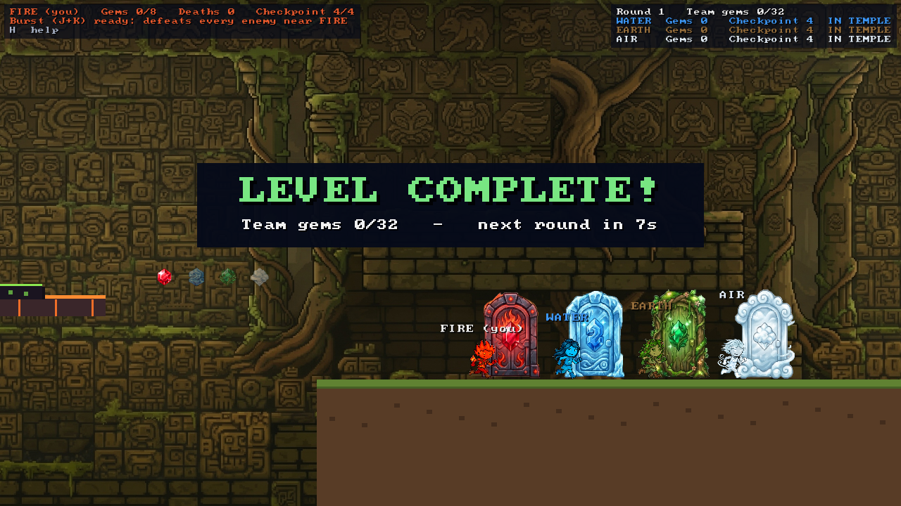
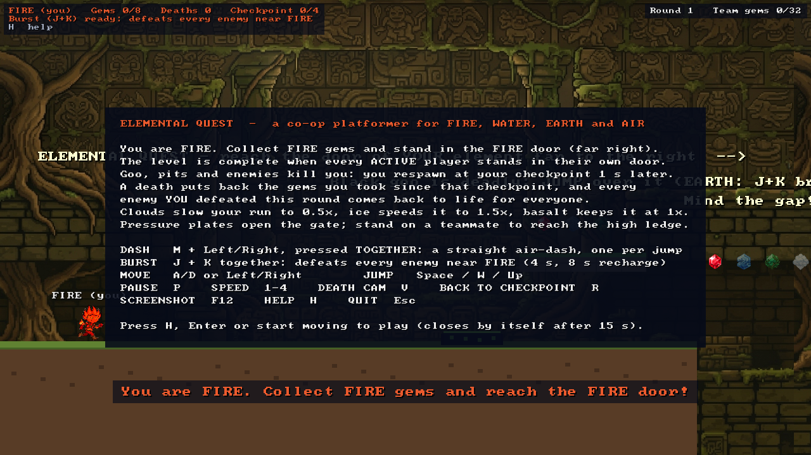

# Elemental Quest

**A cooperative, networked 2D side-scrolling platformer for 1–4 players, written in C++17 on a custom game engine.**



Each player is one of four elements: **FIRE, WATER, EARTH or AIR**. Your element decides your character, the gems you can collect, the temple door you must reach and your **elemental burst**, a special power that helps the whole team. Together you cross an ancient earth temple full of goo pools, patrolling enemies, moving platforms over a bottomless pit, and a gate that only opens while someone stands on a pressure plate.

The game is **client-server**. A headless server owns the shared world (enemies, gems, platforms, the gate and every shared event). Each player's client owns only that player's character.

**▶ Play in your browser: [swethaatgh.github.io/elemental-quest](https://swethaatgh.github.io/elemental-quest/)**: create a room, share its 4-letter code with up to 3 friends, and play. Nothing to install. (Or [build the desktop version](#building-from-source).)

---

## Table of contents

- [Features](#features)
- [Screenshots](#screenshots)
- [How to play](#how-to-play)
- [Play in your browser](#play-in-your-browser)
- [Deploying the online version](#deploying-the-online-version)
- [Building from source](#building-from-source)
- [Running the game](#running-the-game)
- [Command-line options](#command-line-options)
- [How it works](#how-it-works)
- [Project structure](#project-structure)
- [Known limitations](#known-limitations)
- [Credits](#credits)

---

## Features

- **1–4 player online co-op.** Players can join and leave at any time; elements are assigned in join order.
- **Four elemental bursts.** FIRE clears enemies, WATER freezes a moving platform, EARTH raises a stone bridge over goo, AIR holds teammates in place.
- **Cooperative puzzles.** Hold a pressure plate so others can pass the gate, or stand still so a teammate can climb on you to reach a high ledge.
- **Shared consequences.** When you die, the enemies you defeated and the gems you collected since your last checkpoint come back for everyone.
- **Automatic death cam.** Every death replays your last 3 seconds in slow motion, with captions showing what happened ("Dash right", "Fell to your death").
- **Input chords.** Press keys together for moves: **M + ←/→** to air-dash, **J + K** to burst.
- **Surface physics.** Ice speeds you up (1.5x), clouds slow you down (0.5x).
- **Per-player time control.** Pause your own clock or play at 0.5x–2x speed without affecting anyone else.
- **Custom engine.** Entity/component world, physics, collisions, an event system, snapshot networking over ZeroMQ, a job system, and replay, all built from scratch on SDL3.

---

## Screenshots

| FIRE burst clears an enemy | WATER burst freezes a moving platform |
|---|---|
|  |  |

| EARTH burst bridges the goo | AIR burst holds teammates in place |
|---|---|
|  |  |

| FIRE holds the plate so WATER can pass the gate | Death-cam replay after falling into goo |
|---|---|
|  |  |

| Teammates are told when someone reaches their temple | Everyone home: level complete |
|---|---|
|  |  |

---

## How to play

### Goal

Collect your element's gems (8 each) and stand in **your own element's temple door** at the far right of the level. The level is complete when every active player is inside their door. A new round starts 10 seconds later, with gems and enemies rebuilt.

### Controls

| Key | Action |
|---|---|
| **A / D** or **← / →** | Move |
| **Space / W / ↑** | Jump |
| **M + ← / →** (together) | Air dash (one per jump) |
| **J + K** (together) | Elemental burst (8 s cooldown) |
| **R** | Return to your last checkpoint |
| **V** | Death cam on / off (also skips a playing replay) |
| **P** | Pause your own game clock |
| **1–4** or **[ ]** | Your game speed: 0.5x / 1x / 1.5x / 2x |
| **O** | Show hidden checkpoints and danger zones |
| **H** · **F12** · **Esc** | Help · screenshot · quit |

### Elemental bursts

Each burst lasts 4 seconds and is shown on every player's screen.

| Element | Burst effect |
|---|---|
| **FIRE** | Defeats every enemy within 350 px |
| **WATER** | Freezes the next moving platform ahead in place |
| **EARTH** | Raises a one-way stone bridge over the next goo pool |
| **AIR** | Freezes every other player within 350 px (great for keeping teammates still) |

### The world

- **Platforms:** temple ground, moss stone, ice (fast), cloud (slow, one-way), basalt; plus a raft, a lift and a glider that carry you across the pit.
- **Hazards:** goo pools and pits kill on contact. Enemies kill you from the side, but you can **stomp** them from above.
- **Gems:** you can only collect gems of your own element; the others are shown faded.
- **Checkpoints (hidden):** the last one you crossed, in either direction, is where you respawn. Crossing one also banks your gems.
- **Death:** you become a ghost on everyone's screen, watch the death cam, and respawn after 1 second. There are no lives.

### The level, left to right

| Area | What's there |
|---|---|
| Start | Spawn points, moss-stone ledge, first goo pool, a small gap |
| Checkpoint 1 | Floating steps of cloud, ice and basalt |
| Checkpoint 2 | First enemy, then **the pit**, crossed on moving platforms |
| Checkpoint 3 | Second enemy, a **high ledge** that needs a teammate, two **pressure plates** and a **gate** |
| Checkpoint 4 | Third enemy, then the **300 px temple gap**: a running jump or a dash |
| End | The four temple doors |

### Co-op tips

- **Gate:** one player holds a pressure plate while the others pass. The gate closes 2.5 s after the last plate is released.
- **High ledge:** one player stands still and another jumps on their head.
- **Pit:** WATER can freeze a platform so others can land on it.
- **Enemies:** FIRE clears them. Be careful, because if you die, the enemies you stomped come back for everyone.

### HUD

| Top left: you | Top right: your team |
|---|---|
| Your element, gems, deaths and checkpoint; whether your burst is ready (and what it does) or recharging | The round, the team's gem total, and each teammate's gems, checkpoint and status (`DEAD`, `IN TEMPLE`, `PAUSED`) |

Banners at the bottom announce bursts, returning enemies, temples reached and the gate. Press **H** at any time for the help screen:



---

## Play in your browser

1. Open **[swethaatgh.github.io/elemental-quest](https://swethaatgh.github.io/elemental-quest/)**. If nobody has played for a while, the server takes up to a minute to wake up; the page tells you when it's ready.
2. **Create room** to get a 4-letter code (e.g. `KQRT`), or type a friend's code and **Join room**. Sharing the room's link works too.
3. **Enter the temple.** Players get FIRE, WATER, EARTH and AIR in the order they join. Playing alone is fine.

Click the game once so it receives your keys. The controls are the same as the desktop version. Keep the tab in front while you play: browsers pause background tabs, and a paused player is disconnected after a few seconds.

---

## Deploying the online version

The online version has two parts, both free:

```
 GitHub Pages (the website)                 Render (the game server)
 ┌───────────────────────────┐   WebSocket  ┌──────────────────────────────────────┐
 │ lobby page + the game     │ ───────────▶ │ gateway (Node.js): rooms, relay      │
 │ compiled to WebAssembly   │   + /api     │   └─ one elemental_server per room   │
 └───────────────────────────┘              └──────────────────────────────────────┘
```

- **[`web/`](web/)** is the website: the lobby page, plus the game client compiled to WebAssembly with [Emscripten](https://emscripten.org/). A GitHub Actions workflow ([`.github/workflows/pages.yml`](.github/workflows/pages.yml)) builds it and publishes it with GitHub Pages on every push to `main`.
- **[`server/gateway/`](server/gateway/)** runs on Render from the [`Dockerfile`](Dockerfile). Browsers can't speak ZeroMQ, so the gateway gives each room its own `elemental_server` process (the same server as the desktop game), joins it on a browser's behalf, and relays the messages over one WebSocket.

### 1. The game server on Render

1. Sign in at [render.com](https://render.com) with your GitHub account (free, no card needed).
2. **New → Blueprint**, choose this repository, and confirm. Render reads [`render.yaml`](render.yaml) and creates a free web service called `elemental-quest`. The first build takes about 10 minutes.
3. When it's live, open `https://<your-service>.onrender.com/api/health`. It should show `{"ok":true,...}`.

`render.yaml` only lets `https://swethaatgh.github.io` use the server (`ALLOWED_ORIGINS`), and allows 4 rooms at a time (`MAX_ROOMS`), since a free instance has only a small slice of a CPU.

### 2. The website on GitHub Pages

1. If your Render address differs from `https://elemental-quest.onrender.com`, put it in [`web/config.js`](web/config.js), then commit and push.
2. On GitHub: **Settings → Pages → Source: GitHub Actions**.
3. Push to `main` (or run the **Website** workflow from the **Actions** tab). In about 10 minutes the site is live at `https://swethaatgh.github.io/elemental-quest/`.

### Free-tier notes

- A free Render service **sleeps after 15 minutes without visitors**. The first visitor then waits 30–60 s while it wakes; the website shows a "waking the temple" message meanwhile. Render's paid plan removes the sleep.
- Rooms live in the server's memory, so a restart or redeploy ends every game in progress.
- Each player downloads about 50 KB/s while playing (snapshots send only what changed).

### Testing the online version on your own computer

```bash
# 1. The game server (desktop build, see below) and the gateway
cmake -S . -B build -DCMAKE_BUILD_TYPE=Release && cmake --build build -j
cd server/gateway && npm install && STATIC_DIR=../../build-web/web npm start   # port 8080

# 2. The website (needs the Emscripten SDK: https://emscripten.org/docs/getting_started/downloads.html)
bash scripts/build-web.sh
# then open http://localhost:8080/?server=http://localhost:8080
```

---

## Building from source

### Requirements

- **CMake 3.20+**
- A **C++17** compiler (Apple Clang, Clang or GCC)
- **SDL3** and **SDL3_image**
- **ZeroMQ** (`libzmq`) and **cppzmq** (its header-only C++ binding)
- `pkg-config`

> The game has been developed and tested on **macOS**. Linux should work with the same steps. Native Windows is not supported yet (the client uses POSIX signals); on Windows, try WSL2.

### macOS (Homebrew)

```bash
brew install cmake pkg-config sdl3 sdl3_image zeromq cppzmq
```

### Linux (Debian / Ubuntu)

```bash
sudo apt install build-essential cmake pkg-config libzmq3-dev cppzmq-dev
# SDL3 and SDL3_image: install libsdl3-dev / libsdl3-image-dev if your distribution
# packages them; otherwise build them from source:
#   https://github.com/libsdl-org/SDL      (cmake -B build && cmake --build build && sudo cmake --install build)
#   https://github.com/libsdl-org/SDL_image (same steps)
```

### Build

```bash
git clone https://github.com/SwethaatGH/elemental-quest.git
cd elemental-quest
cmake -S . -B build -DCMAKE_BUILD_TYPE=Release
cmake --build build -j
```

This produces:

- `build/elemental_server`: the headless game server
- `build/elemental_client`: one game window per player
- `build/assets/`: sprites, copied next to the client automatically

---

## Running the game

Always start the **server first**, then one **client per player**. Players get FIRE, WATER, EARTH and AIR in the order they join; a fifth player is refused.

### Single player

```bash
./build/elemental_server &
./build/elemental_client
```

The level can be finished solo. Step on the pressure plate, then run for the gate: it stays open for 2.5 s after you leave the plate. Only the gem cluster on the high ledge needs a teammate, and you don't need every gem to finish.

### Multiplayer on one computer

Open a terminal per program:

```bash
./build/elemental_server                                   # terminal 1: server
./build/elemental_client --window 960x540 --pos 0,30       # terminal 2: FIRE
./build/elemental_client --window 960x540 --pos 960,30     # terminal 3: WATER
./build/elemental_client --window 960x540 --pos 0,600      # terminal 4: EARTH
./build/elemental_client --window 960x540 --pos 960,600    # terminal 5: AIR
```

Or launch a full four-player game in a 2×2 grid with one command:

```bash
( ./build/elemental_server &
  sleep 0.5
  for i in 0 1 2 3; do
    ./build/elemental_client --window 960x540 --pos $(( (i % 2) * 960 )),$(( 30 + (i / 2) * 570 )) &
    sleep 0.7
  done
  wait )
```

### Multiplayer on a local network (LAN)

On the host machine:

```bash
./build/elemental_server
```

Find the host's local IP address (macOS: `ipconfig getifaddr en0`; Linux: `hostname -I`). Then on every player's machine:

```bash
./build/elemental_client --host 192.168.1.42     # the server's IP address
```

The server uses **TCP ports 7555, 7556 and 7600–7603**. Allow them through the host's firewall if asked.

### Stopping

Press **Esc** in each game window, then **Ctrl-C** in the server's terminal. To force-close everything:

```bash
pkill -x elemental_client; pkill -x elemental_server
```

---

## Command-line options

### Client (`elemental_client`)

| Option | Meaning |
|---|---|
| `--host HOST` | Server hostname or IP address (default `localhost`) |
| `--window WxH` | Window size, e.g. `960x540` |
| `--pos X,Y` | Window position on screen |
| `--scale S` | Starting game speed (0.5, 1, 1.5, 2) |
| `--checkpoint N` | Start at checkpoint N (1–4), handy for practising a section |
| `--no-deathcam` | Start with the death cam off |
| `--no-help` | Skip the help screen |
| `--show-hidden` | Show hidden objects (death zones, checkpoints) |
| `--walk` | Demo mode: runs right and jumps by itself |
| `--autoshot S` | Take a screenshot after S seconds |
| `--event-log` | Print every event raised and handled |

### Server (`elemental_server`)

| Option | Meaning |
|---|---|
| `--event-log` | Print every event raised and handled |
| `--port-base N` | Use ports N, N+1 and N+45–N+48 instead of 7555, 7556 and 7600–7603 (the web gateway runs one server per room this way) |
| `--client-timeout-ms MS` | Silence after which a player counts as disconnected (default 3000) |

### Both

| Option | Meaning |
|---|---|
| `--encoding text\|binary` | Snapshot encoding (default `binary`) |
| `--delta on\|off` | Send only what changed since the last keyframe |
| `--keyframe N` | Full snapshot every N snapshots when deltas are on |

Every 5 seconds each program prints `[net]` and `[events]` statistics, and the server logs game events in plain words:

```
[game] FIRE burst #1: defeats every enemy near FIRE (2 affected)
[game] FIRE died (goo): 1 enemy(ies) and 2 gem(s) come back
```

---

## How it works

### The engine

The engine in [`engine/`](engine/) is a reusable C++17 static library built on SDL3:

| Module | What it does |
|---|---|
| `World`, `Entity`, `Components`, `Systems` | Entity/component object model; components are serialisable values |
| `Physics`, `Collision` | Rigid bodies, gravity, platforms, triggers, death zones |
| `Timeline` | Pausable, scalable clocks; all game time comes from a Timeline |
| `Input` | Key bindings, input events and **chords** (keys pressed together within 0.2 s) |
| `Event`, `EventManager`, `EventSystems` | A queued, prioritised event system with delayed events (`RaiseAfter`) |
| `Network`, `Server`, `Client`, `Peer` | ZeroMQ transport with client-server and peer-to-peer support |
| `Snapshot`, `Serialize`, `NetScene` | World snapshots (text or binary, optional deltas) and shared event streams |
| `Replay` | Records the last few seconds of snapshots and events and plays them back |
| `JobSystem` | A thread pool for parallel game work |

### The event system

- An **event** is a type (a name hashed once to a 32-bit id) plus named parameters (bool, int, float, text, object, point). Because events are plain values, they can be queued, delayed, logged, sent over the network and recorded for replay.
- `Raise` **only queues** an event; handlers run later in `Handle()`, ordered by **priority, then time**. This keeps handlers off the network thread and stops event chains from recursing.
- The engine itself raises `collision`, `death`, `spawn`, `input` and `chord` events, so game code just registers handlers.

### Networking

- **Snapshots** (ZeroMQ PUB/SUB, 60 Hz) carry *what the world looks like now*. Each client sends its own player to the server, which relays all players and the shared world to everyone.
- **Events** travel on a separate, numbered and acknowledged stream that carries *what happened and why*. Retries never run twice, and gaps are detected and reported.
- **Request → validate → result:** a client raises e.g. `burst_request`; the server's validator checks it (right element? cooldown over? close enough?); then the server raises `burst` for every client in one shared order. Invalid requests are refused and counted.
- **Synchronised timers:** a `burst_end` scheduled 4 s after a burst fires at the server's due time on every client, not 4 s plus network delay.
- **In a browser** the same messages travel over one WebSocket through the gateway ([`engine/src/ClientWeb.cpp`](engine/src/ClientWeb.cpp) documents the framing). A browser can't wait for a reply, so requests are sent without blocking and their replies are handled a frame or two later. The desktop client uses the same code path, with replies that simply arrive at once.

### Gameplay as events

A few examples of how the game is built from events:

- **Burst:** `J+K chord` → `burst_request` → server validates → `burst` (to all) → `burst_end` 4 s later undoes it.
- **Death:** `death` → the player becomes a ghost, a `death_report` goes to the server, and the death-cam replay starts. The server brings back that player's defeated enemies and uncollected gems with shared `spawn` events. When the replay ends, the player respawns.
- **Surfaces:** a floor collision with a surface component raises `surface`, which sets run speed (ice 1.5x, cloud 0.5x).

All game event names, tuning values and key bindings live in [`game/elemental_quest/game_events.hpp`](game/elemental_quest/game_events.hpp).

---

## Project structure

```
.
├── CMakeLists.txt              # top-level build
├── engine/                     # the reusable engine (static library)
│   ├── include/engine/         # public headers
│   └── src/                    # implementation
├── game/elemental_quest/
│   ├── client_main.cpp         # the player client: input, HUD, death cam
│   ├── server_main.cpp         # the headless server entry point
│   ├── server_game.cpp/.hpp    # server rules: bursts, gems, gate, validation
│   ├── level.cpp/.hpp          # level layout, ports and constants
│   ├── draw.cpp/.hpp           # rendering
│   ├── components.cpp/.hpp     # game-specific components
│   ├── game_events.hpp         # event names, tuning values, key bindings
│   ├── check_main.cpp          # automated gameplay checks (optional)
│   ├── bench_main.cpp          # network benchmark (optional)
│   └── assets/                 # sprites and backgrounds
├── web/                        # the website: lobby page, styles, server address (config.js)
├── server/gateway/             # rooms + WebSocket relay for browsers (Node.js)
├── scripts/build-web.sh        # builds the browser version into build-web/web
├── Dockerfile, render.yaml     # the game server on Render
├── .github/workflows/pages.yml # publishes the website with GitHub Pages
└── screenshots/                # images used in this README
```

To build the optional automated checks and benchmark:

```bash
cmake -S . -B build -DELEMENTAL_TOOLS=ON
cmake --build build -j
./build/elemental_check
```

---

## Known limitations

- **Desktop version tested on macOS.** Linux should work; Windows needs WSL2.
- **Up to 4 players** per room (or per desktop server).
- **Online version:** keyboard only (no touch controls), and a tab left in the background is disconnected after a few seconds. On Render's free tier the first visit after a quiet spell waits for the server to wake.
- **Clients are trusted with their own position.** The server validates requests, but a modified client could move freely.
- **Death-cam replays are local:** you see your own deaths replayed, not your teammates'.
- If the server stops, the game stops for everyone.

---

## Credits

- **Game design and implementation:** Swetha Manivasagam
- **Engine:** developed collaboratively with teammates as part of a team engine project; the browser build (WebSocket client, browser main loop) was added for the online version
- Built with [SDL3](https://www.libsdl.org/), [SDL3_image](https://github.com/libsdl-org/SDL_image) and [ZeroMQ](https://zeromq.org/)
